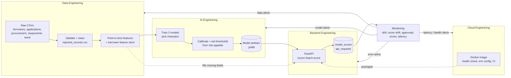

# Credit Decisioning Platform

An end-to-end lending platform for **clinics and pharmacies** that need short-term finance to buy stock.
It takes messy business data, turns it into trusted features, trains a credit risk model, serves
decisions through an API, runs in Docker, and monitors itself. When something goes wrong, the monitoring
tells you **which engineering team should fix it**.

The project covers four engineering domains working as **one system**:

| Domain | Its job in this platform | Main code |
|---|---|---|
| **Data Engineering** | Ingest, validate and clean raw data; build point-in-time features | `src/data/` |
| **AI Engineering** | Train, calibrate and evaluate the model; set thresholds; explain decisions | `src/models/` |
| **Backend Engineering** | Serve scores, decisions and reason codes through a FastAPI service | `src/api/` |
| **Cloud Engineering** | Package with Docker, configure by environment, CI, deployment path | `Dockerfile`, `docker-compose.yml`, `src/cloud/` |
| *Monitoring (all four)* | Check drift, scores, approvals, errors and latency, and route each issue to its owner | `src/monitoring/` |

All data is synthetic. No real customer data is used.

---

## 1. The business problem in plain words

A lender wants to say "yes" or "no" to a clinic's loan request **in seconds**, without collateral.
Manual review is slow and inconsistent. But you can't just plug in a model:

- if the **data** is wrong, the features are wrong,
- if the **features** are wrong, the model's scores are wrong,
- if the **API** is unreliable, nobody can use the scores,
- if **deployment and monitoring** are weak, nobody notices when any of the above breaks.

This platform shows all four pieces working together on the same lending use case.

## 2. How the pieces connect



**Step by step** (each step's output is the next step's input):

1. **Data Engineering starts the flow.** `generate.py` creates two years of raw data. `clean.py` checks every
   record against a contract (`validate.py`): duplicate IDs, impossible dates, negative amounts, unknown
   partners, inconsistent labels like `PHARMACY ` vs `pharm`. It fixes what it safely can, rejects the rest,
   and logs **why**.
2. **AI Engineering builds on clean data.** `feature_engineering.py` builds 15 features per application using
   only what was known **on the application date**, so there is no peeking at the future. `train.py` trains logistic
   regression, random forest and gradient boosting on Jul 2023-Dec 2024, chooses a champion on Jan-Mar 2025,
   calibrates it, sets thresholds from the business's risk appetite, and tests it on later, untouched months.
3. **Backend Engineering exposes the model.** `src/api/` loads the artefact and returns a score, decision,
   credit limit, tenor and plain-English reason codes. Fields a caller leaves out are filled from the
   feature store (a field sent as `null` means "no data" and is never filled in). Every call is logged with a
   request ID and latency.
4. **Cloud Engineering makes it run anywhere.** One Docker image with a health check runs as the API, the
   dashboard, or the monitoring job. Configuration comes from environment variables, and CI tests every change.
5. **Monitoring closes the loop.** Post-launch applications (Jan-Mar 2026) are sent through the real API.
   Monitoring compares that live traffic with the period before launch, and assigns each finding to the
   layer that owns the fix.

## 3. Quick start

You need [uv](https://docs.astral.sh/uv/) (Python package manager) and, for the container route, Docker.

### Option A: run locally

```bash
make setup        # install dependencies (uv sync)
make pipeline     # data -> model -> simulated live traffic -> monitoring -> reports (~20 s)
make api          # start the API on http://localhost:8000  (interactive docs: /docs)
make dashboard    # in a second terminal: http://localhost:8501
make test         # 45 tests
```

No `make`? Use the commands inside the `Makefile`, e.g. `uv run python -m src.run_pipeline`.

### Option B: run in Docker

```bash
docker compose up -d --build                    # API :8000 + dashboard :8501 (model is built into the image)
docker compose --profile jobs run --rm monitor  # send live traffic to the container API, run monitoring + reports
docker compose down                             # stop
make docker-reset                               # after changing code: wipe volumes, rebuild, restart
```

### Run one stage at a time

```bash
uv run python -m src.run_pipeline --only clean          # just validation/cleaning
uv run python -m src.run_pipeline --from train          # retrain and everything after
uv run python -m src.run_pipeline --from simulate --api-url http://localhost:8000   # monitor a running API
```

Monitoring reads the API's own decision log, so it must run where that log is visible: `make api` + `make monitor`
locally (same `data/platform.db`), or `make docker-monitor` for the Docker API (shared volume). Pointing a local
monitor at the Docker API stops with a clear message instead of reporting on an empty log.

## 4. The API

| Method | Endpoint | Purpose |
|---|---|---|
| `POST` | `/score` | Score one application |
| `POST` | `/batch-score` | Score up to 1,000 applications |
| `GET` | `/health` | Readiness: `200 ok`, or `503 degraded` when the model or database is unavailable |
| `GET` | `/model-info` | Live model version, features, thresholds, test metrics |
| `GET` | `/metrics-summary` | Model metrics + live decision mix + error rate + latency + latest monitoring status |
| `POST` | `/admin/reload-model` | Load a newly trained model without restarting |

Only `application_id`, `borrower_id` and `requested_amount` (at least 1,000) are required. Any behaviour signal
you **leave out** is looked up in the borrower feature store; a signal you send as **`null`** means "no data" and is
left empty. Input is strict: amounts must be numbers (not `"25000"` or `true`), and infinities, absurd values and
blank IDs are rejected with a 422.

```bash
curl -X POST http://localhost:8000/score -H 'Content-Type: application/json' -d '{
  "application_id": "APP-10025",
  "borrower_id": "BOR-0301",
  "requested_amount": 25000,
  "recent_procurement_value": 180000,
  "late_payment_count_90d": 1,
  "repayment_rate_180d": 0.91,
  "stock_turnover_ratio": 1.3
}'
```

Real response (trimmed):

```json
{
  "request_id": "req_e866edb9b75a",
  "model_version": "v1.0.0",
  "score": 0.9445,
  "probability_of_default": 0.0555,
  "decision": "approve",
  "risk_band": "strong",
  "recommended_limit": 25000.0,
  "recommended_tenor_months": 6,
  "reason_codes": ["consistently active over the last year", "growing procurement volumes", "established repeat borrower"],
  "reason_details": [{"feature": "procurement_frequency_90d", "value": 4.0, "impact": -0.0313, "direction": "increases risk"}],
  "features_from_store": ["procurement_frequency_90d", "avg_order_value_90d", "..."],
  "missing_core_features": [],
  "timestamp": "2026-11-01T17:56:59Z"
}
```

Bad input is rejected before it reaches the model:

```json
{"request_id": "req_326b7ae1b95f", "error": "validation_error",
 "detail": [{"field": "requested_amount", "message": "Input should be greater than or equal to 1000"}]}
```

### How a decision is made (`src/models/decision.py`)

`score` = the calibrated probability that the borrower repays.

| Rule | Decision |
|---|---|
| score >= approve threshold (0.80, set so at most ~6% of approved loans default) | **approve** |
| 0.70 <= score < approve threshold | **manual_review** |
| score < 0.70 (default risk above 30%) | **decline** |
| 2+ of the core signals missing (procurement, repayment history, stock, payment timeliness), or purchases unknown | **manual_review** at best |
| approved, but purchases too small to support the minimum limit | **manual_review** (never "approve" with a 0 limit) |

Limits: the requested amount x a band factor (100% strong / 80% standard / 50% review), capped at 75% of the
borrower's average monthly purchases.

## 5. Results from the current run

**Model** (out-of-time test: applications Apr-Jun 2025, see `reports/business/model_card.md`)

| | Model (random forest) | Manual underwriter |
|---|---:|---:|
| Approval rate | 84.6% | 85.5% |
| Bad rate among approved | **6.3%** | 7.1% |
| Defaults flagged before lending | **46%** | 39% |
| ROC-AUC | 0.788 | - |
| Expected calibration error | 0.015 | - |

At almost the same approval rate, the model lets through about 11% fewer bad loans and catches more defaults.

**Data quality**: 689,924 raw rows checked, 855 removed (0.12%), 86 labels fixed. Every removal is in
`data/processed/rejected_records.csv` with its reason.

**Monitoring** compared live API traffic (Jan-Mar 2026) with the 9 months before launch and found the problems
planted in the data, routing each to the team that owns it:

| What happened in the data | What monitoring reported | Owner |
|---|---|---|
| New partner P09 sends no stock data and its borrowers have no history | `missing_data_spike` ALERTs on stock and partner fields: "99% of the gaps come from partner P09". None of P09's 132 applications is auto-approved (87 manual review, 45 declined) | Data Eng -> AI Eng |
| Supply shortage in Kano and Mombasa | `segment_drift` ALERTs: loan-to-purchases ratio and sales trend moved in those two regions. Nairobi also alerts, because P09's new, thin-history borrowers are based there | Data Eng |
| Overall approval rate fell from 86.5% to 69.2%; manual review rose from 6% to 19% | `approval_rate_shift`, `manual_review_rate` ALERTs (largely the P09 data gap above) | AI Eng |
| The borrower base matured (more repeat borrowers than before launch) | `feature_drift` WARN on `prior_loan_count` and `active_months_12m`: a real population change to keep an eye on, not a broken feed | Data Eng / AI Eng |
| Prices rose about 18% (loan requests *and* purchases) | `requested_amount` drift stayed below the warning level (PSI 0.08) because purchases rose too, so loan-to-purchases was stable outside the shock regions. No false alarm | - |
| A partner integration sends malformed payloads | `client_error_rate` WARN, 3.2% (422 validation errors) | Backend Eng |
| p95 latency 55 ms, service healthy | `latency_p95`, `service_availability`: OK | Cloud Eng |

The full feedback loop is in `reports/business/monitoring_summary.md`.

## 6. Where everything lands

```text
data/raw/                 source CSVs (as received)
data/processed/           clean tables (Parquet), features, feature store, validation report, rejected records
data/platform.db          SQLite: clean tables + model_scores + api_requests + monitoring_snapshots
data/monitoring/          monitoring_checks.csv, feature_drift.csv
artifacts/models/         credit_model_v1.0.0.joblib + latest.json   (the "model registry")
reports/metrics/          training_metrics.json, threshold_simulation.csv, monthly_model_performance.csv
reports/business/         data_validation_report, model_card, scoring_summary, drift_report,
                          approval_trend_report, high_risk_applications, monthly_model_performance,
                          monitoring_summary   (Markdown)
reports/figures/          ROC, calibration, threshold simulation, confusion matrix, drift, approval trends, latency
```

## 7. Project structure

```text
credit-decisioning-platform/
  src/
    config/settings.py           all paths and settings, from environment variables
    data/                        generate, ingest, validate, clean, feature_engineering
    models/                      train, evaluate, calibrate, explain, decision, predict
    api/                         main (routes + logging), schemas (contracts), services (logic)
    monitoring/                  simulate_traffic, drift, score_checks, reporting
    cloud/deployment_notes.md    Cloud Run / ECS / Azure Container Apps, storage, CI/CD, operations
    utils/                       logger, paths, db
    run_pipeline.py              one command for the whole flow
  dashboard/app.py               Streamlit analyst dashboard
  tests/                         validation, features, models, API, monitoring (45 tests)
  docs/data_dictionary.md        tables, fields, features, outputs
  Dockerfile, docker-compose.yml, .env.example, Makefile, .github/workflows/ci.yml
```

## 8. Design decisions worth knowing

- **Time-based splits, not random.** Train on Jul 2023-Dec 2024, choose and calibrate on Jan-Mar 2025, test on
  Apr-Jun 2025, so the model is always judged on later borrowers than it learned from.
- **Behaviour history starts a year before lending**, so even the first applications have a full 12 months of
  purchases behind them, and `prior_loan_count` is capped at 3 so the model never extrapolates to repeat-borrowing
  levels it has not seen.
- **The simpler model is preferred.** Logistic regression wins unless another model is better by more than 0.01 AUC
  on validation, because it's easier to explain to credit committees and regulators.
- **Calibration before thresholds.** Thresholds are set on calibrated probabilities, so "0.70" really means
  "about 30% default risk".
- **One scoring path.** The batch pipeline and the API both call `CreditScorer.score_frame`, and both build
  `loan_to_procurement_ratio` with the same function. Re-scoring the 600 live applications offline gives the same
  decisions the API gave, because the API only fills fields a caller *leaves out*, never ones sent as `null`.
- **Missing data never becomes a reason.** Reason codes only use values the borrower actually has; missing data
  is reported as "limited data" instead.
- **Monitoring uses real API traffic**, not a copy of the training data, and compares it with the 9 months
  before launch. Drift against the original training months is also reported (`psi_vs_training`).
- **uv + `pyproject.toml` + `uv.lock`** instead of `requirements.txt`, for reproducible installs (the PRD's
  `requirements.txt` role is played by the lock file).
- **SQLite** keeps setup at zero. Only `src/utils/db.py` would change for PostgreSQL.

## 9. Limitations

- Synthetic data: patterns are realistic but designed. Results show the method, not real-world performance.
- During the pilot every application was funded, so outcomes exist for all of them (no reject inference).
- Labels of late-2024 training loans mature in 2025, overlapping the validation/test months. A strict backtest
  "as of" Jan 2025 would only have outcomes up to mid-2024; the effect is small here because the synthetic
  data is stable over time, but a real model would need that stricter setup.
- The feature store is a "latest known" snapshot, right for real-time scoring today. Replaying older applications
  must send their point-in-time values (as the simulator does) rather than rely on the store.
- Live loan outcomes are not known yet, so live monitoring watches inputs and decisions, not accuracy.
  `label_maturity` reminds you to join outcomes after 6 months.
- Security (auth, IAM, encryption) is out of scope for this version. See the deployment notes for what to add.
