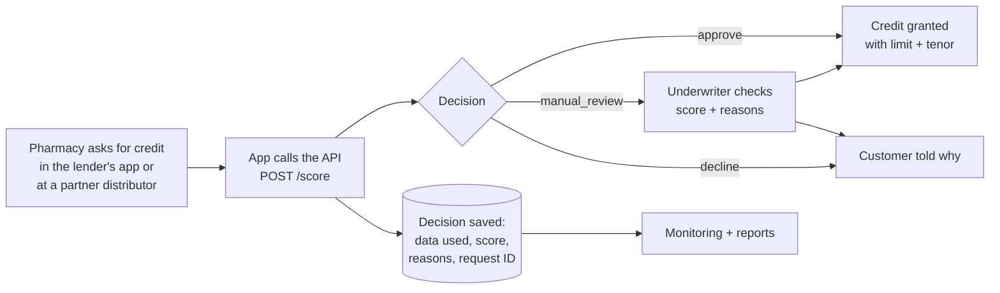

# Using the Platform in a Real Lending Business

This guide explains how a lender that finances stock for pharmacies and clinics (for example a health-supply
company such as 10MG) would use this platform day to day, what it already does, what must be added before it
lends real money, and how to roll it out safely.

The technical details are in the [README](../README.md), the [data dictionary](data_dictionary.md) and the
[deployment notes](../src/cloud/deployment_notes.md). This document is about the business.

---

## 1. What the platform does for the business

A pharmacy asks for credit to restock. Today an underwriter checks its history by hand: slow, hard to scale,
and two underwriters can reach different answers on the same case.

The platform gives a first answer in under a second, using data the lender already has:

- **how much stock the pharmacy buys** (procurement),
- **whether it repays on time** (repayments),
- **how fast its stock sells** (stock movements),
- **how the partner distributor's other borrowers behave** (partner risk).

Clear cases are decided automatically. Unclear cases go to an underwriter, with the score and the reasons
already prepared. Every decision is recorded, and the platform keeps checking itself so problems are found
early.

## 2. The journey of one loan request



1. **Request.** A pharmacy asks for, say, 40,000 to restock. The request comes from the lender's app or a
   partner distributor's ordering system.
2. **Scoring.** That system calls `POST /score` (or `POST /batch-score` for many at once). Anything it does not
   send is looked up in the borrower feature store.
3. **Decision**, returned instantly:

   | Decision | When (`src/models/decision.py`) | What happens next |
   |---|---|---|
   | **approve** | Score at or above 0.80 (set so at most about 6% of approved loans default) | Credit granted with the recommended limit and tenor |
   | **manual_review** | Score between 0.70 and 0.80, or key data missing (new borrower, unknown purchases), or purchases too small for the minimum limit | An underwriter decides |
   | **decline** | Score below 0.70 (default risk above 30%) | Customer is told the main reasons |

4. **Limit and tenor.** The limit is the requested amount x a band factor (100% strong, 80% standard, 50%
   review), **never more than 75% of the pharmacy's average monthly purchases**, so nobody borrows more than
   their business supports. Tenor is up to 12 months (strong), 6 (standard) or 3 (review).
5. **Reasons.** Up to three plain-English reasons, such as "repaid 100% of recent instalments" or
   "3 late payments in the last 90 days". Missing data is never used as a reason; it is reported as
   "limited data" instead.
6. **Record.** The decision, the exact data used, the reasons, the model version and a request ID are saved in
   `model_scores`; the call itself (status, latency) in `api_requests`. This is the audit trail.

## 3. Who uses which part

| Team | What they use | What they get |
|---|---|---|
| **Credit / underwriting** | Dashboard: *Score an application*, *Decisions log* | Only the hard cases reach them, each with a score and reasons. Consistent decisions they can explain |
| **Partners and the lender's app** | The API (`/score`, `/batch-score`) | Instant answers at checkout ("buy now, pay later" for stock) |
| **Risk team** | Threshold report, model card, monthly performance | The trade-off between approving more and accepting more defaults, in numbers (`reports/metrics/threshold_simulation.csv`) |
| **Data engineering** | Data validation report, rejected records, data alerts | Which source sent bad data, which rule it broke, how many rows |
| **AI / data science** | Drift report, score and approval alerts, model card | When the model's inputs or behaviour change, and when to retrain |
| **Backend / cloud engineering** | Error-rate, latency and health alerts, `/health`, `/metrics-summary` | Whether the service is up, fast and receiving valid requests |
| **Compliance / governance** | Model card, decision log, reason codes | What the model uses, how it was tested, and why each customer got their decision |
| **Management** | Monthly reports, dashboard *Overview* | Approval rate, default rate, volumes, trends by region and partner |

## 4. The business questions it answers

| Question | Where the answer is |
|---|---|
| Should this borrower be approved or declined? | `POST /score`, or the dashboard *Score an application* tab |
| Which signals influenced the decision most? | `reason_codes` and `reason_details` in every response |
| Which cases need manual review? | `decision = manual_review`; `reports/business/high_risk_applications.md` |
| How much credit, and for how long? | `recommended_limit`, `recommended_tenor_months` |
| Is the model better than our manual process? | `reports/business/model_card.md`: model vs underwriter on the same loans |
| What threshold should we use? | `reports/metrics/threshold_simulation.csv` and its chart |
| Has incoming data changed since training? | `reports/business/drift_report.md` |
| Are approval rates shifting by partner or region? | `reports/business/approval_trend_report.md`, segment checks |
| Is a partner sending broken or incomplete data? | `missing_data_spike` alerts name the partner responsible |
| Are API requests succeeding? Is it fast? | `/metrics-summary`, `client_error_rate`, `latency_p95` checks |
| Who should fix each problem? | Every monitoring check has an owner (Data / AI / Backend / Cloud) |

## 5. A normal week

| When | Who | What |
|---|---|---|
| **All day** | API | Scores requests; underwriters work the manual-review queue |
| **Every night** | Monitoring job (`make docker-monitor` locally; a scheduled job in the cloud) | Runs all checks, writes `monitoring_snapshots`, refreshes the reports |
| **Every morning** | Data + AI engineering | Read `reports/business/monitoring_summary.md`. Each ALERT has an owner and a suggested action |
| **Weekly** | Credit + risk | Review approval rate, manual-review rate, declines by region and partner; sample some auto-approvals |
| **Monthly** | Risk + management | Monthly performance: predicted vs actual default rate once loans are 6 months old |
| **Quarterly** | Risk + AI engineering | Decide whether to retrain (see section 9) and whether the risk appetite still fits |

**How to react to alerts:**

- **Data alert** (missing fields, a partner's feed broke, a region's numbers jumped): fix the data first.
  Never retrain on broken data, or the model learns the mistake.
- **Model alert** (scores or approval rate moved): check whether the cause is a data problem. If not, it may be
  a real change in the market (for example a supply shock); the risk team decides whether to tighten thresholds
  or retrain.
- **Backend alert** (many 422 errors): a partner's integration is sending bad requests. Share the error details
  (every 422 explains which field is wrong).
- **Cloud alert** (slow, or `/health` returns 503): scale out or restart; check the model file and database.

## 6. What is ready and what must be added

| Area | Ready in this project | Must be added before lending real money |
|---|---|---|
| Data | Validation contract, cleaning, rejected-records log, point-in-time features | Connections to the real systems (orders, repayments, stock); scheduled data loads |
| Model | Three models compared, calibration, thresholds from a risk appetite, model card | Retraining and sign-off on the lender's **own** history |
| Decisions | Approve / review / decline, limits, tenors, reasons | Business sign-off on the rules; customer-facing wording for decline reasons |
| Underwriter workflow | Dashboard to score and inspect decisions | A review queue and a way to **record the underwriter's final decision** (section 8) |
| API | Strict validation, request IDs, health checks, batch scoring | Login / API keys per partner, rate limits, private network access |
| Storage | SQLite (zero setup) | PostgreSQL (only `src/utils/db.py` changes), backups, retention rules |
| Cloud | Docker image, CI, deployment notes for Cloud Run, ECS and Azure | A real cloud account, staging + production environments, alerts to email or Slack |
| Monitoring | Drift, segments, partner data gaps, approvals, errors, latency | Joining real outcomes after 6 months to track accuracy |
| Governance | Decision log, model card, reasons | Model approval process, fairness review, data-protection review (section 7) |

> **Important:** the results in the README (84.6% approval, 6.3% bad rate) come from **synthetic data**. They
> show the method works, not how the model will perform on a real loan book. Real numbers come from step 1 below.

## 7. Governance and compliance checklist

Confirm the details with the lender's legal and compliance team. Rules differ by country.

- [ ] **Data protection.** Borrower data is personal or business data: check the local law (for example
      Nigeria's Data Protection Act 2023, Kenya's Data Protection Act 2019). Record the lawful basis or consent,
      keep only what is needed, and keep personal data out of logs.
- [ ] **Lending regulation.** Check which rules apply to this kind of credit (the central bank, and any
      consumer-protection or digital-lending regulator).
- [ ] **Explain declines.** Customers should be told the main reasons. The `reason_codes` give a starting
      point; compliance should approve the final wording.
- [ ] **Fairness.** Check approval and default rates by region, business type (clinic vs pharmacy) and
      partner, before launch and every quarter. The segment reports are a starting point. A big gap that the
      risk factors cannot explain needs investigating.
- [ ] **Model approval.** A credit or risk committee signs off the model card, thresholds and risk appetite
      before go-live, and again after every retrain.
- [ ] **Audit trail.** Keep `model_scores` (data used, score, decision, reasons, model version, request ID)
      for as long as the regulator requires.
- [ ] **Human in charge.** Underwriters can override any decision, and the model never makes a final decline
      without a way for the customer to ask for a review.
- [ ] **Security.** API keys or login for every caller, private network access, encrypted storage, restricted
      `/admin/*` endpoints (see the deployment notes, section 6).

## 8. Underwriter overrides

Underwriters will sometimes disagree with the model. Those disagreements are valuable: they show where the model
is weak. This is **not built yet**. The recommended design:

1. Add a table `underwriter_decisions` with `request_id`, `application_id`, `final_decision`,
   `final_limit`, `underwriter_id`, `reason`, `decided_at`.
2. Add an endpoint (for example `POST /decisions/{request_id}/review`) or a dashboard form to fill it in.
3. Report every month: how often underwriters override, in which direction, and how those loans perform.
4. Use the final decisions and outcomes when retraining, and investigate repeated overrides of the same kind.

## 9. Moving from synthetic data to real data

The pipeline steps stay the same; only the input changes.

1. **Export the six source tables** from the real systems as CSV, Parquet or SQLite: `partners`, `borrowers`,
   `applications`, `procurement_transactions`, `repayments`, `stock_movements`. Use the column names in the
   [data dictionary](data_dictionary.md), or rename columns on the way in. (`incoming_applications.csv` is only
   for the traffic simulator; with real data, live requests come through the API instead.)
2. **Put them in `data/raw/`** and run the pipeline **from the cleaning step**, so the synthetic generator is
   skipped:

   ```bash
   uv run python -m src.run_pipeline --from clean --to train
   ```

3. **Read the data validation report** (`reports/business/data_validation_report.md`) and the rejected records.
   Fix problems at the source where possible. If many rows are rejected, sort that out before trusting a model.
4. **Agree the risk appetite** with credit and finance. The test setting is "at most 6% of approved loans
   default" (`TARGET_BAD_RATE_APPROVED` in `src/models/train.py`); the approve threshold is calculated from it.
5. **Review the model card** (`reports/business/model_card.md`): is the model clearly better than the manual
   underwriter on the same loans? Is it calibrated? Does it behave sensibly by region and partner?
6. **Check the time periods.** The training, validation and test months (`TRAIN_END`, `VALID_END`, `TEST_END`
   in `src/data/feature_engineering.py`) and the monitoring reference window (`REFERENCE_START` in
   `src/monitoring/score_checks.py`) are set for the synthetic data. Move them to match the real history, and keep
   the test months **after** the training months.
7. **Watch out for:** loans that were declined in the past have no outcome, so the model only learns from
   approved loans (reject inference); and loans need about 6 months before their outcome is known.

**When to retrain:** every quarter, or sooner when an AI Engineering alert persists after data problems are
fixed. Each retrain gets a new `MODEL_VERSION`, a new model card, and committee sign-off. The API can load a new
model without a restart (`POST /admin/reload-model`), and rolling back means pointing `MODEL_VERSION` at the
previous version.

## 10. Rolling it out safely

| Phase | How long | What happens | Move on when |
|---|---|---|---|
| **1. Shadow mode** | 1-3 months | The model scores every application, but underwriters still decide everything. Both answers are logged | Once loans mature, the model's would-be approvals default no more often than the underwriters' |
| **2. Small pilot** | 2-3 months | Auto-approve only small loans, for one partner or one region. Everything else goes to underwriters | Default rate within the risk appetite, few overrides, no unexplained fairness gaps |
| **3. Expand** | Ongoing | Raise the loan size limit, add partners and regions one at a time | Monitoring stays healthy after each step |
| **4. Business as usual** | - | Nightly monitoring, monthly reports, quarterly retraining and fairness review | - |

Rollback at any phase: switch the affected segment back to "manual review for all". The API keeps scoring, so
nothing is lost.

## 11. How to measure success

| Measure | Why it matters |
|---|---|
| Time from request to decision | The main promise: seconds instead of days |
| Share of requests decided automatically | How much underwriter time is saved |
| Bad rate among approved loans, against the risk appetite | Growing without taking on more risk |
| Approval rate compared with the manual process | Lending to more pharmacies, not fewer |
| Override rate, and how overridden loans perform | Where the model and the underwriters disagree, and who is right |
| Number of alerts, and time to fix them | Is the system healthy, and do owners act on alerts? |
| Approval and default rates by region, business type and partner | Fairness and concentration risk |

## 12. Business risks and how the platform handles them

| Risk | How it is handled |
|---|---|
| A partner's data feed breaks | `missing_data_spike` alert names the partner; affected borrowers go to manual review instead of being auto-approved |
| A regional shock (supply shortage, flood, unrest) | `segment_drift` alerts per region; the risk team can tighten that region |
| Inflation makes loan sizes grow | Limits are tied to purchases, which rise too; drift checks watch loan-to-purchases |
| The model slowly gets worse | Monthly predicted vs actual default rate once outcomes arrive; quarterly retraining |
| New borrowers have no history | Sent to manual review with a capped limit; missing data is never counted against them as a reason |
| A bad model is released | Committee sign-off, a versioned model file, and rollback through `MODEL_VERSION` |
| Over-reliance on automation | Underwriters handle all borderline cases and can override any decision |
