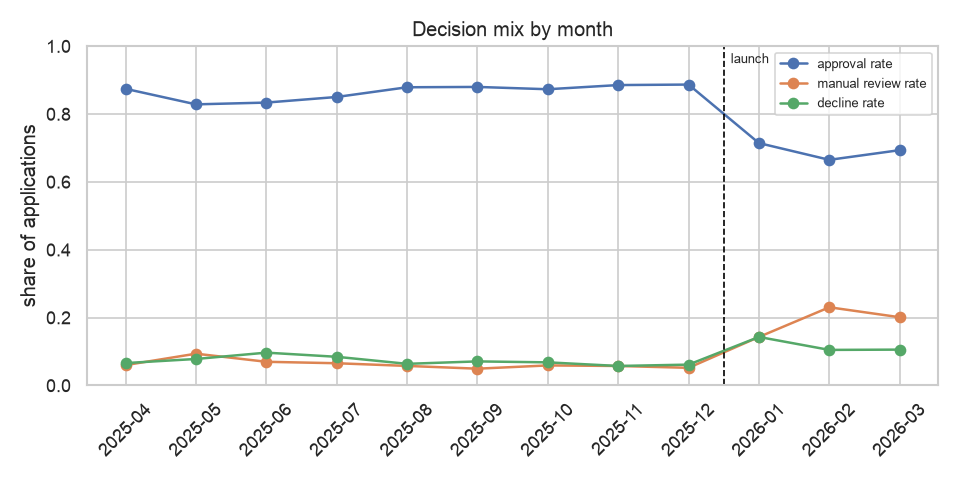
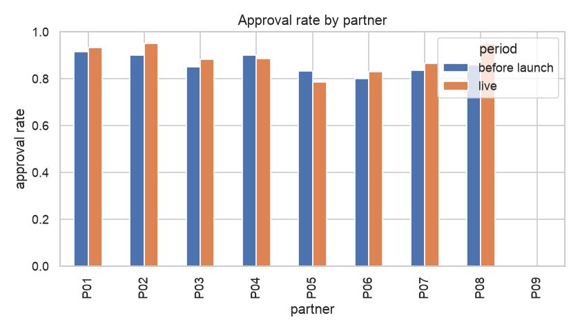

# Approval Trend Report

_Generated 2026-11-01 18:01 UTC by `src/monitoring/reporting.py`_

Are approval rates shifting over time, or for a particular partner?

Before-launch months are the model's decisions on historical applications (what it *would* have
decided). Live months are real API decisions.

## By month

| application_month | period | applications | approval_rate | manual_review_rate | decline_rate |
|---|---|---|---|---|---|
| 2025-04 | before launch | 501 | 87.4% | 6.0% | 6.6% |
| 2025-05 | before launch | 513 | 82.8% | 9.4% | 7.8% |
| 2025-06 | before launch | 445 | 83.4% | 7.0% | 9.7% |
| 2025-07 | before launch | 474 | 85.0% | 6.5% | 8.4% |
| 2025-08 | before launch | 487 | 87.9% | 5.7% | 6.4% |
| 2025-09 | before launch | 466 | 88.0% | 4.9% | 7.1% |
| 2025-10 | before launch | 441 | 87.3% | 5.9% | 6.8% |
| 2025-11 | before launch | 436 | 88.5% | 5.7% | 5.7% |
| 2025-12 | before launch | 424 | 88.7% | 5.2% | 6.1% |
| 2026-01 | live | 210 | 71.4% | 14.3% | 14.3% |
| 2026-02 | live | 191 | 66.5% | 23.0% | 10.5% |
| 2026-03 | live | 199 | 69.3% | 20.1% | 10.6% |

## By partner

| partner_id | before launch | live | change_pp |
|---|---|---|---|
| P01 | 91.5% | 93.2% | 1.7 |
| P02 | 90.1% | 95.1% | 5.0 |
| P03 | 85.2% | 88.2% | 3.1 |
| P04 | 89.9% | 88.6% | -1.3 |
| P05 | 83.2% | 78.6% | -4.6 |
| P06 | 80.0% | 83.0% | 3.0 |
| P07 | 83.5% | 86.4% | 2.9 |
| P08 | 85.9% | 94.9% | 9.0 |
| P09 | - | 0.0% |  |

