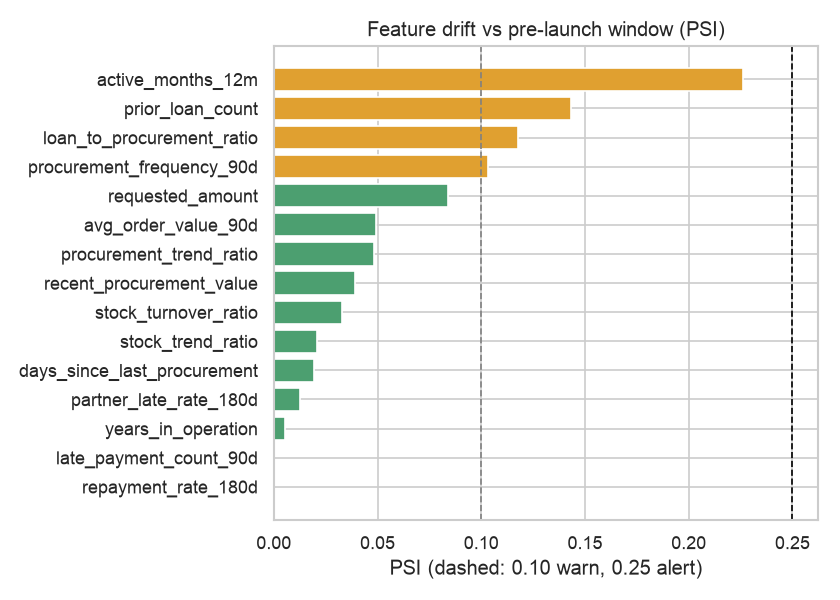

# Drift Report

_Generated 2026-11-01 18:01 UTC by `src/monitoring/reporting.py`_

Has the data arriving at the API changed compared with the 9 months before launch?

How to read this: **PSI** below 0.10 means stable, 0.10-0.25 a moderate shift, above 0.25 a major
shift. **KS** is the largest gap between the two cumulative distributions (0 = identical).
`psi_vs_training` compares with the original 2024 training months, for information only.

Owner: **Data Engineering** (is the feed correct?), then **AI Engineering** (does the model still fit?).

| feature | method | drift_score | drift_status | psi_vs_training | ks_statistic | baseline_median | current_median | baseline_missing_rate | current_missing_rate |
|---|---|---|---|---|---|---|---|---|---|
| active_months_12m | psi | 0.226 | WARN | 0.6093 | 0.1837 | 12.0 | 11.0 | 0.0% | 0.0% |
| prior_loan_count | psi | 0.1431 | WARN | 1.1744 | 0.0896 | 3.0 | 3.0 | 0.0% | 0.0% |
| loan_to_procurement_ratio | psi | 0.1175 | WARN | 0.1046 | 0.1249 | 0.3975 | 0.4652 | 0.0% | 0.0% |
| procurement_frequency_90d | psi | 0.1032 | WARN | 0.031 | 0.1112 | 10.0 | 8.5 | 0.0% | 0.0% |
| requested_amount | psi | 0.084 | OK | 0.0819 | 0.1124 | 26500.0 | 32000.0 | 0.0% | 0.0% |
| avg_order_value_90d | psi | 0.0492 | OK | 0.1077 | 0.0853 | 22025.3745 | 25086.5357 | 0.1% | 0.8% |
| procurement_trend_ratio | psi | 0.0482 | OK | 0.0306 | 0.085 | 1.036 | 1.1019 | 1.1% | 17.5% |
| recent_procurement_value | psi | 0.0391 | OK | 0.0977 | 0.0628 | 200432.1 | 202711.03 | 0.0% | 0.0% |
| stock_turnover_ratio | psi | 0.033 | OK | 0.0374 | 0.0453 | 1.0401 | 1.0356 | 0.2% | 22.2% |
| stock_trend_ratio | psi | 0.0207 | OK | 0.0407 | 0.047 | 1.0423 | 1.0529 | 1.5% | 22.3% |
| days_since_last_procurement | psi | 0.0193 | OK | 0.0145 | 0.0506 | 7.0 | 8.0 | 0.0% | 0.0% |
| partner_late_rate_180d | mean_shift | 0.0128 | OK | 3.4092 | 0.2675 | 0.1906 | 0.1703 | 0.0% | 22.0% |
| years_in_operation | psi | 0.0054 | OK | 0.0052 | 0.0157 | 4.9 | 4.85 | 0.0% | 0.0% |
| late_payment_count_90d | psi | 0.0001 | OK | 0.0271 | 0.0048 | 0.0 | 0.0 | 0.0% | 0.0% |
| repayment_rate_180d | psi | 0.0 | OK | 0.0035 | 0.0127 | 1.0 | 1.0 | 13.1% | 22.3% |

## Drift inside regions

| subject | status | explanation |
|---|---|---|
| Kano: recent_procurement_value | WARN | in Kano, median recent_procurement_value moved 212642.150 -> 191386.740 (PSI 0.200, 59 live applications) |
| Kano: loan_to_procurement_ratio | ALERT | in Kano, median loan_to_procurement_ratio moved 0.404 -> 0.638 (PSI 0.779, 59 live applications) |
| Kano: stock_trend_ratio | WARN | in Kano, median stock_trend_ratio moved 1.069 -> 0.876 (PSI 0.229, 59 live applications) |
| Lagos: recent_procurement_value | WARN | in Lagos, median recent_procurement_value moved 203512.360 -> 241001.980 (PSI 0.107, 109 live applications) |
| Lagos: stock_trend_ratio | WARN | in Lagos, median stock_trend_ratio moved 1.039 -> 1.176 (PSI 0.169, 109 live applications) |
| Mombasa: recent_procurement_value | WARN | in Mombasa, median recent_procurement_value moved 184321.940 -> 171567.500 (PSI 0.106, 64 live applications) |
| Mombasa: loan_to_procurement_ratio | ALERT | in Mombasa, median loan_to_procurement_ratio moved 0.436 -> 0.566 (PSI 0.275, 64 live applications) |
| Mombasa: stock_trend_ratio | ALERT | in Mombasa, median stock_trend_ratio moved 1.027 -> 0.831 (PSI 0.425, 64 live applications) |
| Nairobi: recent_procurement_value | WARN | in Nairobi, median recent_procurement_value moved 206751.005 -> 171312.345 (PSI 0.143, 192 live applications) |
| Nairobi: loan_to_procurement_ratio | ALERT | in Nairobi, median loan_to_procurement_ratio moved 0.387 -> 0.532 (PSI 0.260, 192 live applications) |

