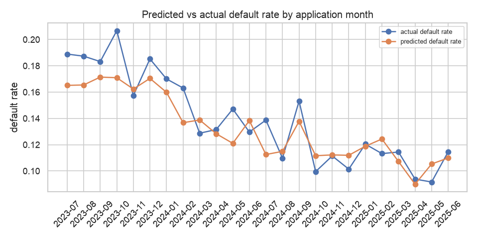

# Monthly Model Performance Summary

_Generated 2026-11-01 18:01 UTC by `src/monitoring/reporting.py`_

Model `v1.0.0` (random_forest). Out-of-time test: ROC-AUC **0.788**, auto-approval **84.6%**, bad rate among approved **6.3%**.

## Historical months (outcomes known)

Predicted default rate tracking the actual rate means the model is well calibrated over time.

| month | split | applications | actual_default_rate | predicted_default_rate | average_score | auto_approval_rate | roc_auc |
|---|---|---|---|---|---|---|---|
| 2023-07 | train | 270 | 18.9% | 16.5% | 0.8349 | 70.4% | 0.8885 |
| 2023-08 | train | 299 | 18.7% | 16.5% | 0.8346 | 67.9% | 0.889 |
| 2023-09 | train | 262 | 18.3% | 17.1% | 0.8286 | 67.9% | 0.8847 |
| 2023-10 | train | 329 | 20.7% | 17.1% | 0.8291 | 67.2% | 0.8256 |
| 2023-11 | train | 343 | 15.7% | 16.2% | 0.8377 | 72.3% | 0.8657 |
| 2023-12 | train | 405 | 18.5% | 17.0% | 0.8296 | 68.6% | 0.8893 |
| 2024-01 | train | 353 | 17.0% | 16.0% | 0.8402 | 72.5% | 0.9006 |
| 2024-02 | train | 282 | 16.3% | 13.7% | 0.8633 | 76.2% | 0.8751 |
| 2024-03 | train | 334 | 12.9% | 13.9% | 0.8612 | 76.6% | 0.9016 |
| 2024-04 | train | 365 | 13.2% | 12.8% | 0.8717 | 79.2% | 0.8701 |
| 2024-05 | train | 401 | 14.7% | 12.1% | 0.879 | 79.8% | 0.8846 |
| 2024-06 | train | 378 | 13.0% | 13.8% | 0.8617 | 74.9% | 0.8515 |
| 2024-07 | train | 411 | 13.9% | 11.2% | 0.8875 | 82.7% | 0.8769 |
| 2024-08 | train | 392 | 11.0% | 11.5% | 0.8851 | 83.7% | 0.9065 |
| 2024-09 | train | 392 | 15.3% | 13.8% | 0.8623 | 75.3% | 0.9134 |
| 2024-10 | train | 412 | 10.0% | 11.2% | 0.8884 | 80.6% | 0.8867 |
| 2024-11 | train | 449 | 11.1% | 11.2% | 0.8878 | 81.7% | 0.8792 |
| 2024-12 | train | 444 | 10.1% | 11.2% | 0.8881 | 82.7% | 0.8932 |
| 2025-01 | validation | 432 | 12.0% | 11.9% | 0.8812 | 81.0% | 0.7667 |
| 2025-02 | validation | 371 | 11.3% | 12.4% | 0.8757 | 77.1% | 0.8362 |
| 2025-03 | validation | 472 | 11.4% | 10.7% | 0.8928 | 83.9% | 0.8514 |
| 2025-04 | test | 501 | 9.4% | 9.0% | 0.9101 | 87.4% | 0.7653 |
| 2025-05 | test | 513 | 9.2% | 10.5% | 0.8947 | 82.8% | 0.7845 |
| 2025-06 | test | 445 | 11.5% | 11.0% | 0.8901 | 83.4% | 0.8114 |

## Live months (outcomes not yet known)

A loan's outcome is only known after 6 months on book, so live months show predictions only.

| application_month | applications | average_score | approval_rate | predicted_default_rate | actual_default_rate |
|---|---|---|---|---|---|
| 2026-01 | 210 | 0.87 | 71.4% | 13.0% | not yet known |
| 2026-02 | 191 | 0.878 | 66.5% | 12.2% | not yet known |
| 2026-03 | 199 | 0.886 | 69.3% | 11.4% | not yet known |

