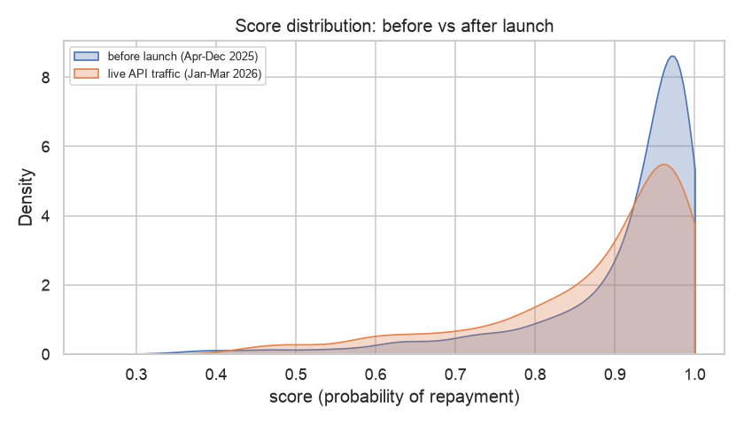

# Scoring Summary Report

_Generated 2026-11-01 18:01 UTC by `src/monitoring/reporting.py`_

Who was scored through the API, and what did the platform decide?

- Applications scored: **600**
- Approved: **415** (69.2%)
- Manual review: **114** (19.0%)
- Declined: **71** (11.8%)
- Average score: **0.878**
- Total recommended credit (approved): **15,203,500**

## By partner

| partner_id | applications | avg_score | approval_rate | avg_limit |
|---|---|---|---|---|
| P01 | 59 | 0.942 | 93.2% | 30,203 |
| P02 | 61 | 0.922 | 95.1% | 38,902 |
| P03 | 51 | 0.906 | 88.2% | 46,784 |
| P04 | 70 | 0.921 | 88.6% | 32,836 |
| P05 | 56 | 0.884 | 78.6% | 27,955 |
| P06 | 53 | 0.881 | 83.0% | 26,208 |
| P07 | 59 | 0.906 | 86.4% | 33,305 |
| P08 | 59 | 0.931 | 94.9% | 33,356 |
| P09 | 132 | 0.754 | 0.0% | 12,920 |

## Most common reason codes

| reason | applications |
|---|---|
| consistently active over the last year | 225 |
| stock sells through quickly | 191 |
| frequent stock ordering | 154 |
| healthy procurement activity | 134 |
| limited data: no repayment history or stock data | 133 |
| infrequent stock ordering | 133 |
| loan size is modest relative to purchases | 132 |
| established repeat borrower | 128 |

